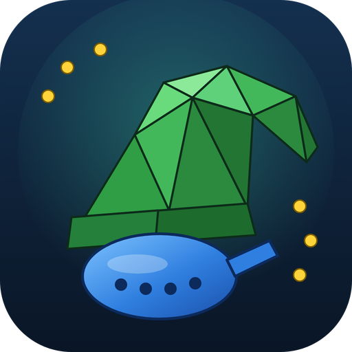

# ZMP: cooperativo en línea para Ocarina of Time

[English](README.md) | **Español**

**ZMP** (Zelda Multiplayer) permite que **de 2 a 6 amigos jueguen juntos a The Legend of Zelda: Ocarina of Time en
línea**, cada uno con su propio Link de verdad, y todos viendo exactamente el mismo mundo: los mismos enemigos, los
mismos golpes, los mismos puzles, fotograma a fotograma. Pueden ir juntos o separarse por Hyrule; el progreso
(objetos, rupias, llaves, cofres, la hora del día) es compartido por todo el grupo. Funciona en Windows y en el
navegador.

Está construido sobre [Ship of Harkinian](https://github.com/HarbourMasters/Shipwright), el port para PC de Ocarina of
Time, que a su vez se apoya en la [descompilación de Ocarina of Time](https://github.com/zeldaret/oot). **No incluye
ninguna parte del juego original**: cada jugador necesita su propia ROM.

> **Hecho con IA.** ZMP lo hizo un solo jugador que **no es programador** pero conoce este juego a fondo, trabajando
> con agentes de programación con IA (Claude, de Anthropic) que escribieron el código, las pruebas y estas guías bajo
> su dirección. Él decidió cómo debía sentirse y jugarse el cooperativo, lo jugó y juzgó los resultados; los agentes
> hicieron la ingeniería. El código tiene licencia MIT para que cualquiera pueda usarlo, aprender de él y mejorarlo.

## Cómo funciona (con honestidad)

ZMP es multijugador **lockstep** (en paso sincronizado). El PC de cada jugador ejecuta el juego entero, y todos los PC
reciben exactamente las mismas entradas en el mismo orden, así que todos calculan el mismo mundo. En medio hay un
pequeño **servidor de retransmisión**, `zmp-server`, que ordena los botones de todos, los reenvía y guarda la partida
compartida de cada sala. No ejecuta el juego, así que es diminuto (un programa de 7 MB, con muy poca CPU y memoria).
**El juego lo arranca por ti** cuando pulsas **Alojar y jugar**; también puede funcionar solo en un PC libre, en un VPS
barato, como relé o sobre una LAN virtual como Tailscale o ZeroTier. No hay un servidor central de ZMP, ni cuentas, ni
registro: cada grupo usa su propio servidor.

Consecuencias que debes conocer:

- Todos en una sala necesitan **la misma compilación** del juego y **la misma versión de la ROM**.
- Lockstep espera a la conexión más lenta: se juega mejor si todos están en la misma región.
- Los jugadores de escritorio y los de navegador no pueden compartir sala (son compilaciones distintas); un mismo
  servidor puede alojar ambos tipos.

## Jugar en 5 pasos

1. **Descarga** `ZMP-<version>-windows.zip` desde [Releases](../../releases/latest) y descomprímelo en una carpeta normal.
2. **Abre `soh.exe`** y, la primera vez, elige tu ROM de Ocarina of Time (`.z64`/`.n64`/`.v64`); el juego construye
   sus datos a partir de ella en uno o dos minutos. [Detalles](docs-zmp/es/02-your-rom.md)
3. **Alguien aloja**: en la ventana "Sala ZMP", pestaña **Alojar**, pulsa **Alojar y jugar**, luego **Copiar
   codigo**, pasa el código de invitación a los amigos y carga una partida. [Guía para alojar](#alojar-una-partida)
4. **Los amigos entran**: pestaña **Unirse**, pegan el código y pulsan **Unirse con este codigo** (en la misma red de
   casa, la partida también aparece en la lista "En tu red local"). [Cómo jugar](docs-zmp/es/03-play.md)
5. **Juega**: quédate cerca o sepárate. A un amigo caído se le reanima manteniendo A a su lado durante 3 segundos.

## Alojar una partida

**[Pulsa Alojar partida y pásale el código a tu amigo](docs-zmp/es/00-host-and-send-the-code.md).** El juego arranca
su propio servidor, pide a tu router que abra el puerto (UPnP, NAT-PMP o PCP) y muestra un código de invitación
(`ZMP-...`) y un enlace `zmp://` para pasar. Una línea "Desde internet" dice con honestidad si los amigos de internet
pueden llegar. Las salas tienen contraseña (se la inventa el juego), y nunca viaja en claro.

Si no llegan (CGNAT, un router sin UPnP), plan B:

- [Un PC que solo aloja](docs-zmp/es/04-host-on-your-pc.md): `zmp-server.exe` con doble clic, con su propia página.
- [Abrir el puerto a mano](docs-zmp/es/09-open-the-port-by-hand.md) en tu router.
- [Tailscale o ZeroTier](docs-zmp/es/05-host-with-a-virtual-lan.md): sin cambios en el router, funciona detrás de CGNAT.
- [Un relé](docs-zmp/es/11-relay.md): cualquier `zmp-server` en internet arrancado con `-relay`.
- [Un VPS con Docker](docs-zmp/es/06-host-on-a-vps.md): siempre encendido (`docker compose up -d --build`).
- [wss:// para navegadores](docs-zmp/es/12-wss-for-browsers.md) en páginas `https`.

## Modo navegador

El mismo juego compilado a WebAssembly: juega en Chrome, Edge o Firefox sin instalar nada. Un navegador no puede
alojar: alguien arranca un servidor con la versión para navegador (`zmp-server -web <carpeta>`), los amigos abren
`http://<host>:47100/`, escriben una sala y un nombre (o abren la página con un código de invitación) y eligen su ROM
desde su propio ordenador; se convierte en la memoria de la pestaña y nunca se sube ni se guarda. Un sitio puede dejar
puesto su servidor con un `zmp-config.json`.
[Guía del modo navegador](docs-zmp/es/07-browser-mode.md)

## Estado

Demostrado por las pruebas automáticas del proyecto (manejan instancias reales del juego con bots; "seis jugadores"
significa seis instancias del juego en una sala):

- Las fases de desarrollo 0 a 6 están cerradas (la última, el 2026-11-07).
- Última pasada completa de pruebas, 2026-11-05: 249 de 251 pruebas en verde, 0 en rojo (las otras 2 son solo
  manuales).
- Pruebas de mutación: las pruebas detectaron 136 de 136 compilaciones rotas a propósito.
- Los 10 jefes de la historia (Gohma, Rey Dodongo, Barinade, Ganon Fantasma, Volvagia, Morpha, Bongo Bongo, Twinrova,
  Ganondorf y Ganon) vencidos con seis jugadores.
- Seis pestañas del navegador juegan en lockstep, con el mismo estado del juego en cada tick.

En curso: una partida completa con seis jugadores por internet y una sesión larga en el navegador.

Límites conocidos: las pantallas de multijugador de ZMP están en español y en inglés (siguen el idioma del sistema),
pero algunas líneas de estado y del chat siguen solo en español; el juego de escritorio
solo funciona en Windows; hasta 6 jugadores por sala; los jugadores de escritorio y los de navegador no pueden compartir
sala; no hay chat de texto; los paquetes de texturas y de modelos no funcionan en multijugador; una sola Navi por sala
(la de quien crea la sala).

## Estructura del repositorio

Este repositorio es un fork de Ship of Harkinian: el código del juego está en la raíz, como en el original, con ZMP
dentro. Junto a él:

| Ruta | Qué es |
|---|---|
| raíz (`soh/`, `libultraship/`, `torch/`, `CMakeLists.txt`...) | El juego: Ship of Harkinian con ZMP (`soh/soh/Zmp/` y los cambios marcados con `// ZMP:` en los archivos originales); libultraship y Torch como carpetas normales. La página del navegador está en `soh/web/`. El README propio de Ship of Harkinian: [README-SoH.md](README-SoH.md). |
| [`server/`](server/) | `zmp-server`, el servidor de salas/retransmisión (Go): TCP para el juego de escritorio y WebSocket para el navegador en un solo puerto, y opcionalmente los archivos de la página del navegador. Dockerfile y archivo de compose en `server/deploy/`. |
| [`web/`](web/) | `make_web.py`: empaqueta la compilación del navegador en una carpeta lista para servir. |
| [`tools/`](tools/) | Empaquetado (`package_windows.py`), binarios del servidor (`build_server.py`), la comprobación de que una versión no lleva datos de la ROM (`check_release.py`) y las guías que van dentro del zip. |
| [`docs-zmp/`](docs-zmp/) | Las guías de ZMP en [inglés](docs-zmp/en/README.md) y [español](docs-zmp/es/README.md): conseguir el juego, tu ROM, alojar y pasar el código, jugar, plan B para alojar (servidor con doble clic, router, LAN virtual, relé, VPS, wss), modo navegador, la versión web en tu sitio, solución de problemas, compilar, publicar. (`docs/` es de Ship of Harkinian.) |

## Compilación

Consulta [docs-zmp/es/build.md](docs-zmp/es/build.md): Visual Studio 2022 + CMake para Windows, Emscripten para el
navegador, Go para el servidor.

## Licencia

El código propio de ZMP (`server/`, `web/`, `tools/`, `docs-zmp/`, `soh/soh/Zmp/`, `soh/web/zmp-web.js` y nuestros
cambios marcados) tiene la licencia MIT de [LICENSE-ZMP](LICENSE-ZMP), titular S-BlackDragon, y solo cubre esos
archivos. Todo lo demás pertenece a otros proyectos y mantiene sus términos: Ship of Harkinian no tiene archivo de
licencia propio; libultraship y Torch son MIT. [LICENSING.es.md](LICENSING.es.md) explica con exactitud qué es cada cosa,
carpeta por carpeta. No se distribuye ninguna ROM ni ningún asset del juego.

## Créditos

- [Ship of Harkinian](https://github.com/HarbourMasters/Shipwright) de **HarbourMasters**: el port para PC sobre el que
  se construye esto, y [libultraship](https://github.com/kenix3/libultraship) (kenix3) y [Torch](https://github.com/HarbourMasters/Torch).
- La [descompilación de Ocarina of Time](https://github.com/zeldaret/oot) de **zeldaret**, que hizo posible todo esto.
- [ShipWeb](https://github.com/samfisher753/ShipWeb) de **samfisher753**: el port web de Ship of Harkinian del que
  parte la versión para navegador.
- [Anchor](https://github.com/garrettjoecox/anchor) de garrettjoecox, el mod de cooperativo en línea de Ship of
  Harkinian, una referencia al diseñar `zmp-server` (no se incluye nada de su código).
- Código, pruebas y documentación escritos con agentes de programación **Claude** (Anthropic), dirigidos por
  S-BlackDragon.

ZMP es un proyecto de aficionados, no está afiliado ni respaldado por Nintendo, HarbourMasters, zeldaret ni ShipWeb. Por
favor, no les pidas ayuda con ZMP; abre una incidencia (issue) aquí. *The Legend of Zelda* y *Ocarina of Time* son
marcas registradas de Nintendo. No apoyamos la piratería.
