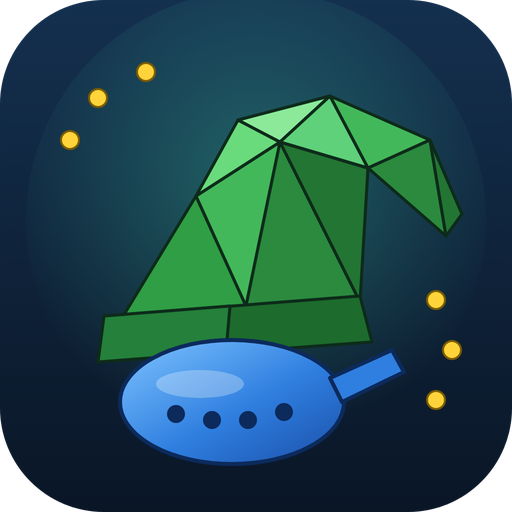

# ZMP: online co-op for Ocarina of Time

**English** | [Español](README.es.md)

**ZMP** (Zelda Multiplayer) lets **2 to 6 friends play The Legend of Zelda: Ocarina of Time together online**, each
with their own real Link, all seeing exactly the same world: the same enemies, the same hits, the same puzzles, frame
by frame. You can stick together or split up across Hyrule; progress (items, rupees, keys, chests, the time of day) is
shared by the whole group. It runs on Windows and in the browser.

It is built on [Ship of Harkinian](https://github.com/HarbourMasters/Shipwright), the PC port of Ocarina of Time,
which builds on the [Ocarina of Time decompilation](https://github.com/zeldaret/oot). **No part of the original game is
included**: each player needs their own ROM.

> **Made with AI.** ZMP was made by one person who is **not a programmer** but knows this game inside out, working
> with AI coding agents (Anthropic's Claude) that wrote the code, the tests and these guides under his direction. He
> decided how the co-op should feel and play, played it, and judged the results; the agents did the engineering. The
> code is MIT licensed so anyone can use it, learn from it and improve it.

## How it works (honestly)

ZMP is **lockstep** multiplayer. Every player's PC runs the whole game, and every PC gets exactly the same inputs in
the same order, so they all compute the same world. In the middle there is a small **relay server**, `zmp-server`,
that puts everyone's buttons in order, passes them on and keeps each room's shared save. It does not run the game, so
it is tiny (one 7 MB program, very little CPU and memory). **The game starts it for you** when you press **Host and
play**; it can also run on its own on a spare PC, a cheap VPS, a relay, or over a virtual LAN like Tailscale or
ZeroTier. There is no central ZMP server, no account and no sign-up: each group uses its own server.

Consequences you should know:

- Everyone in a room needs **the same build** of the game and **the same ROM version**.
- Lockstep waits for the slowest connection: it feels best with everyone in the same region.
- Desktop players and browser players cannot share a room (different builds); one server can host both.

## Play in 5 steps

1. **Download** `ZMP-<version>-windows.zip` from [Releases](../../releases/latest) and unzip it into a normal folder.
2. **Open `soh.exe`** and, the first time, choose your Ocarina of Time ROM (`.z64`/`.n64`/`.v64`); the game builds
   its data from it in a minute or two. [Details](docs-zmp/en/02-your-rom.md)
3. **Someone hosts**: in the "Sala ZMP" (ZMP room) window, **Host** tab, presses **Host and play**, then **Copy
   code**, sends the invite code to the friends, and loads a save. [Hosting guide](#host-a-game)
4. **Friends join**: **Join** tab, paste the code, **Join with this code** (on the same home network the game also
   appears in the "On your local network" list). [How to play](docs-zmp/en/03-play.md)
5. **Play**: stay close or split up. A downed friend is revived by holding A next to them for 3 seconds.

## Host a game

**[Press Host game and send the code to your friend](docs-zmp/en/00-host-and-send-the-code.md).** The game starts its
own server, asks your router to open the port (UPnP, NAT-PMP or PCP), and shows an invite code (`ZMP-...`) and a
`zmp://` link to send. A "From the internet" line says honestly whether friends on the internet can reach you. Rooms
have a password (made up for you), which never travels in clear.

If they cannot reach you (CGNAT, a router without UPnP), plan B:

- [A PC that only hosts](docs-zmp/en/04-host-on-your-pc.md): `zmp-server.exe` with a double click, with its own page.
- [Open the port by hand](docs-zmp/en/09-open-the-port-by-hand.md) on your router.
- [Tailscale or ZeroTier](docs-zmp/en/05-host-with-a-virtual-lan.md): no router changes, works behind CGNAT.
- [A relay](docs-zmp/en/11-relay.md): any `zmp-server` on the internet started with `-relay`.
- [A VPS with Docker](docs-zmp/en/06-host-on-a-vps.md): always on (`docker compose up -d --build`).
- [wss:// for browsers](docs-zmp/en/12-wss-for-browsers.md) on `https` pages.

## Browser mode

The same game compiled to WebAssembly: play in Chrome, Edge or Firefox without installing anything. A browser cannot
host: someone runs a server with the browser build (`zmp-server -web <folder>`), friends open `http://<host>:47100/`,
type a room and a name (or open the page with an invite code), and pick their ROM from their own computer; it is
converted in the tab's memory and never uploaded or stored. A site can preset its server with a `zmp-config.json`.
[Browser mode guide](docs-zmp/en/07-browser-mode.md)

## Status

Proven by the project's automated tests (they drive real game instances with bots; "six players" means six game
instances in one room):

- Development phases 0 to 6 are closed (the last one on 2026-11-07).
- Last full test pass, 2026-11-05: 249 of 251 tests green, 0 red (the other 2 are manual-only).
- Mutation testing: 136 of 136 deliberately broken builds were caught by the tests.
- All 10 story bosses (Gohma, King Dodongo, Barinade, Phantom Ganon, Volvagia, Morpha, Bongo Bongo, Twinrova,
  Ganondorf, Ganon) beaten with six players.
- Six browser tabs play in lockstep, with identical game state on every tick.

In progress: a full game with six players over the internet, and a long session in the browser.

Known limits: ZMP's multiplayer screens are in English and Spanish (they follow the system language), but some
status and chat lines are still only in Spanish; the desktop game is Windows only; up to 6
players per room; desktop and browser players cannot share a room; no text chat; texture and model packs are not
supported in multiplayer; one Navi per room (the room creator's).

## Repository layout

This repository is a fork of Ship of Harkinian: the game's code is at the root, as in the original, with ZMP inside.
Next to it:

| Path | What |
|---|---|
| root (`soh/`, `libultraship/`, `torch/`, `CMakeLists.txt`...) | The game: Ship of Harkinian with ZMP (`soh/soh/Zmp/`, and `// ZMP:` changes in the original files); libultraship and Torch as plain folders. The browser page is `soh/web/`. Ship of Harkinian's own readme: [README-SoH.md](README-SoH.md). |
| [`server/`](server/) | `zmp-server`, the room/relay server (Go): TCP for the desktop game and WebSocket for the browser on one port, optional static files for the browser page. Dockerfile and compose file in `server/deploy/`. |
| [`web/`](web/) | `make_web.py`: packs the browser build into a folder to serve. |
| [`tools/`](tools/) | Packaging (`package_windows.py`), server binaries (`build_server.py`), the release check that no ROM data is shipped (`check_release.py`), and the guides that go into the zip. |
| [`docs-zmp/`](docs-zmp/) | ZMP's guides in [English](docs-zmp/en/README.md) and [Spanish](docs-zmp/es/README.md): get the game, your ROM, host and send the code, play, plan B hosting (double-click server, router, virtual LAN, relay, VPS, wss), browser mode, the web version on your site, troubleshooting, building, releasing. (`docs/` is Ship of Harkinian's.) |

## Building

See [docs-zmp/en/build.md](docs-zmp/en/build.md): Visual Studio 2022 + CMake for Windows, Emscripten for the browser,
Go for the server.

## License

ZMP's own code (`server/`, `web/`, `tools/`, `docs-zmp/`, `soh/soh/Zmp/`, `soh/web/zmp-web.js` and our marked changes)
is under the MIT license in [LICENSE-ZMP](LICENSE-ZMP), holder S-BlackDragon; it covers only those files. Everything
else belongs to other projects and keeps their terms: Ship of Harkinian has no license file of its own; libultraship
and Torch are MIT. [LICENSING.md](LICENSING.md) says exactly what is what, folder by folder. No ROM or game asset is
distributed.

## Credits

- [Ship of Harkinian](https://github.com/HarbourMasters/Shipwright) by **HarbourMasters**: the PC port this is built
  on, and [libultraship](https://github.com/kenix3/libultraship) (kenix3) and [Torch](https://github.com/HarbourMasters/Torch).
- The [Ocarina of Time decompilation](https://github.com/zeldaret/oot) by **zeldaret**, which made all of this
  possible.
- [ShipWeb](https://github.com/samfisher753/ShipWeb) by **samfisher753**: the web port of Ship of Harkinian that the
  browser version starts from.
- [Anchor](https://github.com/garrettjoecox/anchor) by garrettjoecox, Ship of Harkinian's online co-op mod, a
  reference when designing `zmp-server` (no code of it is included).
- Code, tests and documentation written with **Claude** (Anthropic) coding agents, directed by S-BlackDragon.

ZMP is a fan project, not affiliated with or endorsed by Nintendo, HarbourMasters, zeldaret or ShipWeb. Please don't
ask them for help with ZMP; open an issue here. *The Legend of Zelda* and *Ocarina of Time* are trademarks of
Nintendo. We do not condone piracy.
